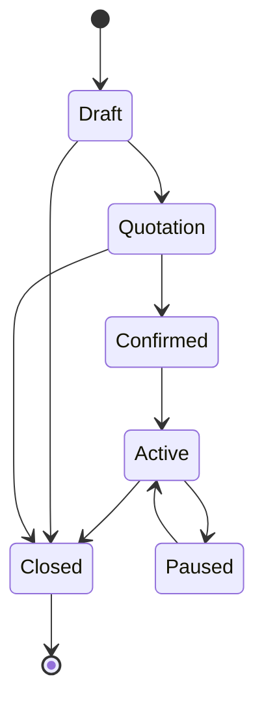
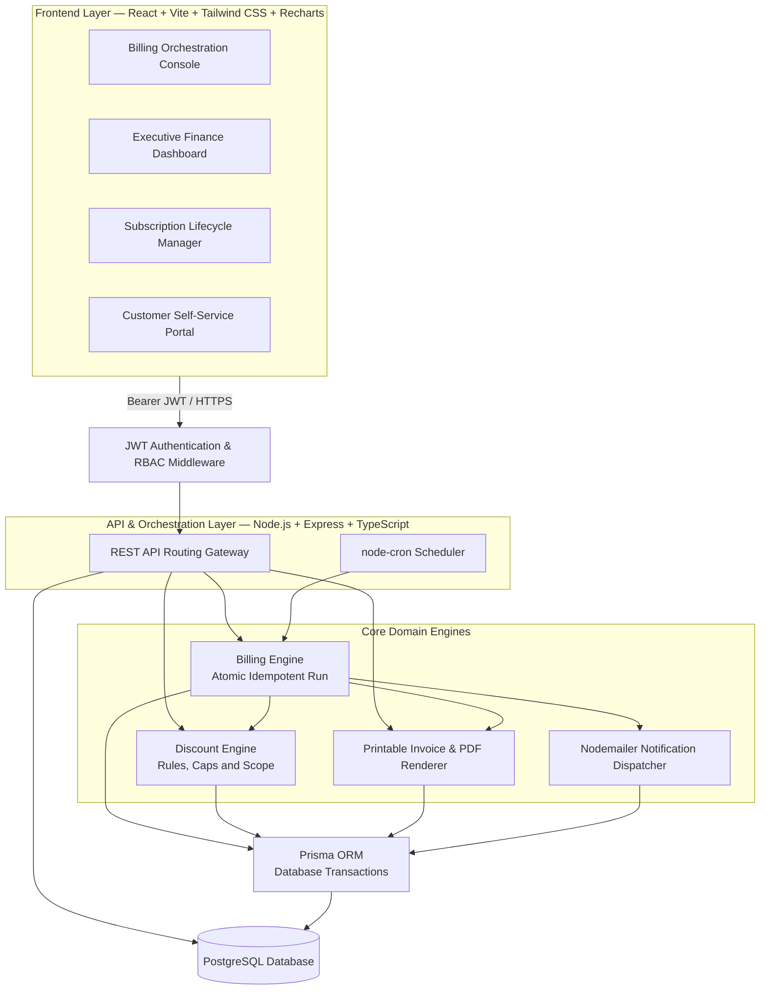
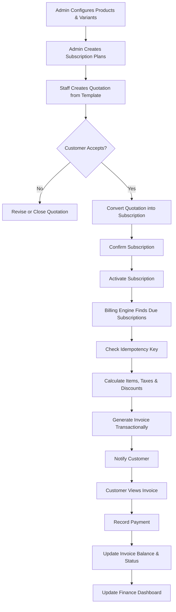
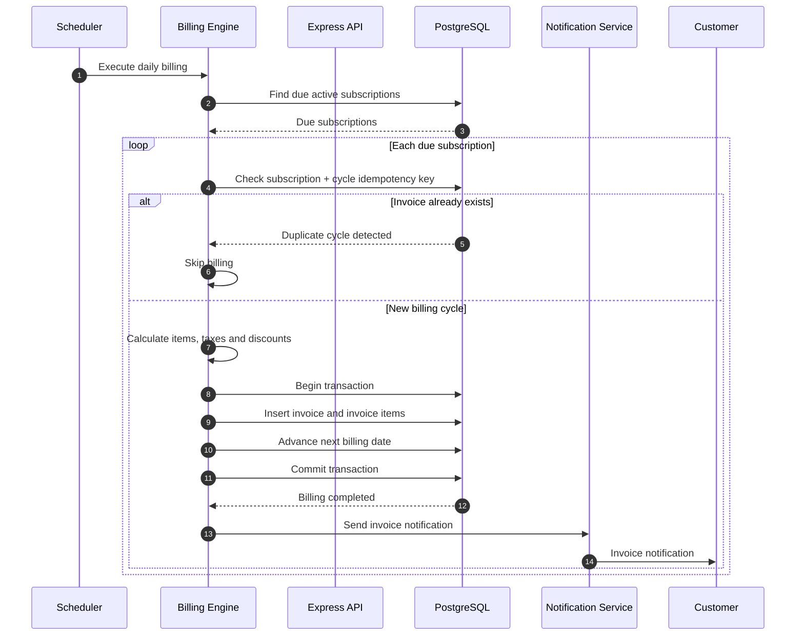
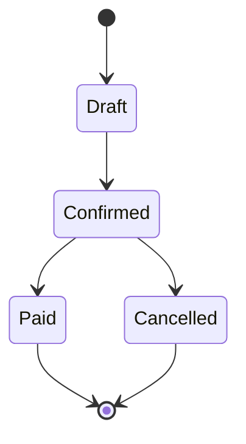
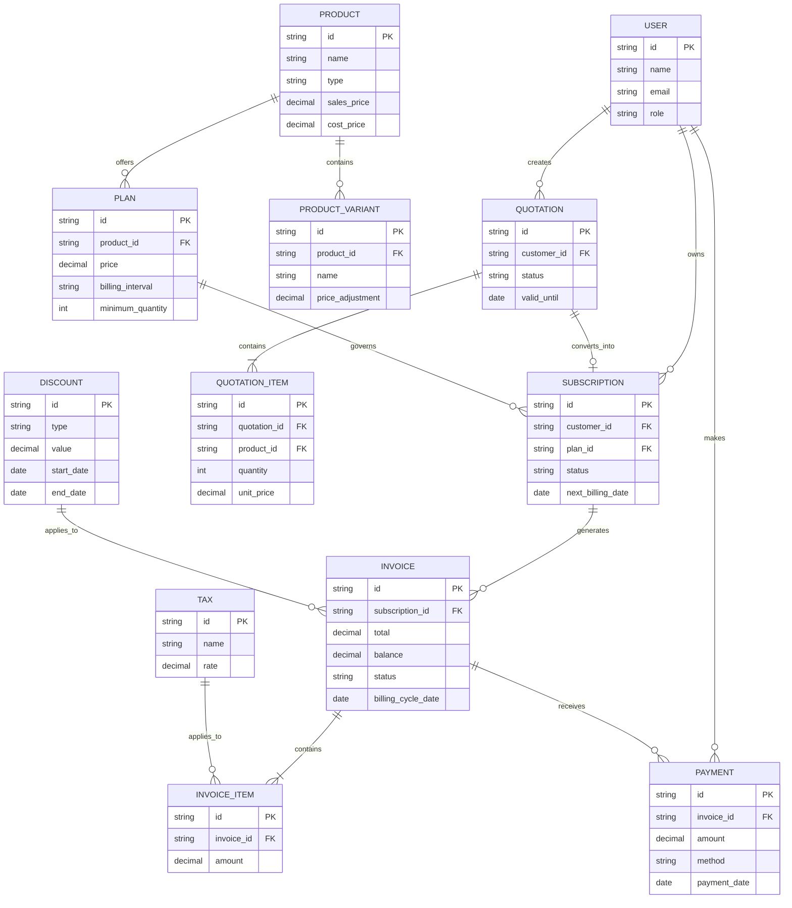
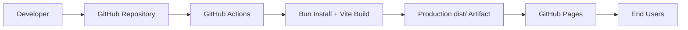

# SUBNEXA
### Smart Subscriptions. Seamless Revenue.

**A Unified Subscription Management Platform with Automated Recurring Billing, Subscription Lifecycle Management and Financial Analytics.**

<p align="center">
  <a href="https://dharshinivasan44.github.io/subnexa-subscription-management/">
    <strong>Live Application</strong>
  </a>
  &nbsp; • &nbsp;
  <a href="https://github.com/dharshinivasan44/subnexa-subscription-management">
    <strong>Source Code</strong>
  </a>
</p>

---

## 1. Project Overview

Subnexa is a subscription management platform designed to centralize recurring business operations, automate billing workflows and improve financial visibility.

Businesses offering recurring products and services often manage quotations, subscriptions, renewals, invoices and payments through disconnected tools and manual processes.

Subnexa aims to bring these operations together through a unified platform that connects the complete subscription lifecycle — from quotation creation to payment settlement and financial reporting.

### Core Objectives

- Centralize subscription and product management.
- Automate recurring invoice generation.
- Maintain accurate subscription lifecycle transitions.
- Prevent duplicate billing through idempotent processing.
- Simplify invoice and payment management.
- Provide real-time financial visibility through MRR, overdue and revenue dashboards.
- Provide separate experiences for administrators, staff and customers.

---

## 2. Problem Statement

Traditional subscription-based businesses frequently encounter operational difficulties:

| Challenge | Business Impact |
|---|---|
| Manual subscription tracking | Missed renewals and inconsistent records |
| Spreadsheet-based billing | Human errors and duplicate entries |
| Manual invoice preparation | Delayed billing operations |
| Disconnected payment records | Difficult payment reconciliation |
| Limited revenue visibility | Inaccurate financial planning |
| No centralized customer portal | Poor customer self-service experience |

Subnexa addresses these challenges through a centralized subscription management and recurring billing workflow.

---

## 3. Proposed Solution

Subnexa combines five major operational areas:

1. **Administration:** Manage products, variants, plans, users, taxes and discounts.
2. **Subscription Operations:** Create quotations, convert them into subscriptions and manage lifecycle transitions.
3. **Recurring Billing:** Generate invoices, calculate applicable taxes and discounts, and prevent duplicate billing.
4. **Customer Self-Service:** Allow customers to access their subscriptions, invoices and payment history.
5. **Finance & Analytics:** Monitor recurring revenue, collected payments and overdue receivables.

---

## 4. Feature Prioritization

### P0 — Must-Have Winning MVP

The following capabilities define the core MVP.

| Feature | Description |
|---|---|
| Subscription Lifecycle | Draft → Quote → Confirmed → Active → Closed |
| Authentication & RBAC | JWT authentication and role-based access control in the target backend |
| Invoice Management | Invoice generation and payment recording |
| Finance Dashboard | MRR, revenue and overdue invoice visibility |
| Product Management | Products, variants and subscription plans |
| Customer Portal | Customer-specific subscription and invoice access |
| Automated Billing | Idempotent recurring billing runner |
| Discount Engine | Fixed and percentage-based discount rules |

### P1 — Optional Polish

| Feature | Description |
|---|---|
| Judge Demo Switcher | One-click demonstration role switching |
| Printable Invoices | Printable HTML and PDF invoices |
| Email Notifications | Nodemailer with safe console fallback |

### Explicitly Out of Scope

The initial MVP does not target:

- Complex multi-tenant database sharding.
- Live Stripe or PayPal webhook listeners.
- Multi-currency foreign exchange rate management.

---

## 5. User Roles and Access Control

| Role | Responsibilities |
|---|---|
| Admin | Manage users, products, plans, discounts, taxes, subscriptions and billing |
| Internal Staff | Manage customers, quotations and subscription operations |
| Customer | View their own subscriptions, invoices and payment records |
| Finance | Access financial overview, revenue analytics and receivables through authorized staff/admin access |

### Access Control Principles

- Only administrators can create internal staff accounts.
- Customers can access only their own subscription and invoice records.
- Administrative operations require appropriate permissions.
- Financial data is restricted to authorized users.
- Backend authorization must validate permissions independently of frontend navigation.

---

## 6. Subscription Lifecycle

A subscription moves through controlled lifecycle states.



**Lifecycle explanation:**

- **Draft:** Subscription or quotation is being prepared.
- **Quotation:** Commercial terms are presented to the customer.
- **Confirmed:** Customer accepts the quotation.
- **Active:** Subscription is activated and becomes eligible for recurring billing.
- **Paused:** Billing is temporarily suspended according to plan rules.
- **Closed:** Subscription is terminated.

Actual allowed transitions must be enforced by the backend lifecycle service in the full-stack implementation.

---

## 7. System Architecture

### 7.1 Target Full-Stack Architecture

The following diagram represents the proposed production-oriented architecture.



**Architecture layers:**

| Layer | Responsibility |
|---|---|
| Frontend | User interfaces and dashboards |
| Authentication | JWT validation and role authorization |
| API Gateway | Request routing and business operations |
| Billing Engine | Recurring invoice generation |
| Discount Engine | Discount eligibility and calculations |
| Notification Dispatcher | Billing and renewal notifications |
| Invoice Renderer | Printable invoice and PDF generation |
| ORM | Database queries and transactional operations |
| PostgreSQL | Persistent business data |

**Implementation note:** This is the proposed target architecture. The currently deployed prototype uses React, TypeScript, Vite and browser localStorage. The Express API, JWT middleware, Prisma and PostgreSQL components are planned backend components, not currently connected production services.

---

## 8. End-to-End Business Workflow

The central Subnexa workflow connects administration, sales, subscription activation, recurring billing and customer payments.



---

## 9. Automated Recurring Billing Engine

Automated billing is one of the most important components of Subnexa.

The target billing engine supports daily, weekly, monthly and yearly billing cadences.

### Billing Execution

1. The scheduler runs daily or an administrator triggers billing on demand.
2. The billing engine identifies active subscriptions whose next billing date is due.
3. An idempotency key is checked before invoice creation.
4. Eligible products, quantities, taxes and discounts are calculated.
5. An invoice is created.
6. The subscription's next billing date is advanced.
7. A customer notification is dispatched.

### Idempotency Strategy

A recurring billing operation must not generate duplicate invoices for the same subscription billing cycle.

Proposed idempotency key:

```text
subscription_id + billing_cycle_date
```

Example:

```text
SUB-1001_2026-10-31
```

The backend should enforce uniqueness using a database constraint and transaction.

### Transactional Billing Flow



**Important:** Invoice creation and next billing date advancement should occur in the same database transaction to prevent inconsistent billing states.

---

## 10. Invoice and Payment Management

### Invoice Lifecycle



### Invoice Capabilities

- Automatic invoice generation.
- Tax calculation.
- Eligible discount application.
- Invoice confirmation and cancellation.
- Printable HTML/PDF representation.
- Invoice balance tracking.
- Payment status management.

### Payment Recording

The target platform supports recording payments against invoices through methods such as:

- Card.
- Bank transfer / wire.
- ACH.

The MVP records payment information and updates invoice balances. Live external payment gateway processing and webhook listeners are explicitly outside the initial scope.

---

## 11. Discount Rules Engine

Subnexa supports configurable discount rules.

| Rule | Description |
|---|---|
| Fixed Discount | Reduces the invoice by a fixed amount |
| Percentage Discount | Applies a percentage reduction |
| Minimum Purchase | Requires a minimum purchase amount |
| Minimum Quantity | Requires a minimum quantity |
| Validity Period | Defines the discount start and end dates |
| Usage Limit | Limits the number of redemptions |
| Product Scope | Restricts eligible products |
| Subscription Scope | Restricts eligible subscription plans |

The backend must validate discount eligibility before applying a discount to an invoice.

---

## 12. REST API Design — Target Backend

The following routes represent the proposed API contract for the full-stack implementation.

| Method | Endpoint | Purpose |
|---|---|---|
| POST | `/api/auth/login` | Authenticate user |
| GET | `/api/products` | Retrieve products |
| POST | `/api/products` | Create product |
| GET | `/api/plans` | Retrieve subscription plans |
| POST | `/api/plans` | Create subscription plan |
| POST | `/api/quotations` | Create quotation |
| POST | `/api/quotations/:id/convert` | Convert quotation into subscription |
| GET | `/api/subscriptions` | Retrieve authorized subscriptions |
| PATCH | `/api/subscriptions/:id/status` | Update lifecycle status |
| GET | `/api/invoices` | Retrieve authorized invoices |
| POST | `/api/payments` | Record invoice payment |
| GET | `/api/finance/overview` | Retrieve finance metrics |
| POST | `/api/billing/run` | Trigger authorized billing run |

All protected routes must enforce authentication and role-based authorization. Customer endpoints must scope queries to the authenticated customer's identity.

These routes are architectural specifications, not a claim that the API endpoints are currently deployed.

---

## 13. Conceptual Database Design

The proposed PostgreSQL data model contains the following core entities:



This is a conceptual entity relationship model. Exact columns, constraints, indexes and relationship cardinalities should be finalized during backend implementation.

---

## 14. Technology Stack

### Current Prototype

| Component | Technology |
|---|---|
| Frontend | React 19 |
| Language | TypeScript |
| Build Tool | Vite |
| Styling | Tailwind CSS |
| Routing | React Router |
| Charts | Recharts |
| Icons | Lucide React |
| State | React Context API |
| Local Persistence | Browser localStorage |
| Package Manager | Bun |
| Hosting | GitHub Pages |
| CI/CD | GitHub Actions |

### Proposed Full-Stack Backend

| Component | Technology |
|---|---|
| Runtime | Node.js |
| Backend Framework | Express.js |
| Backend Language | TypeScript |
| Authentication | JWT |
| Authorization | Role-Based Access Control |
| ORM | Prisma |
| Database | PostgreSQL |
| Scheduler | node-cron |
| Email Notifications | Nodemailer |
| Invoice Rendering | HTML / PDF |

---

## 15. Project Structure

```text
subnexa-subscription-management/
│
├── .github/
│   └── workflows/
│       └── deploy.yml
│
├── src/
│   ├── components/
│   │   ├── common/
│   │   ├── invoices/
│   │   └── layout/
│   │
│   ├── context/
│   │   └── AppContext.tsx
│   │
│   ├── pages/
│   │   ├── admin/
│   │   ├── staff/
│   │   ├── customer/
│   │   ├── finance/
│   │   └── auth/
│   │
│   ├── App.tsx
│   └── main.tsx
│
├── index.html
├── package.json
├── bun.lock
├── tsconfig.json
└── vite.config.ts
```

The structure above describes the current frontend organization. Backend folders will be introduced as the full-stack implementation progresses.

---

## 16. Getting Started

### Prerequisites

- Git
- Bun
- A code editor such as Visual Studio Code

### Clone the repository

```bash
git clone https://github.com/dharshinivasan44/subnexa-subscription-management.git

cd subnexa-subscription-management
```

### Install dependencies

```bash
bun install --frozen-lockfile
```

### Start development server

```bash
bun run dev
```

### Build for production

```bash
bun run build
```

The generated production files are available in the `dist/` directory.

---

## 17. Deployment Architecture

The current frontend prototype is hosted through GitHub Pages.



**Live Application:**

https://dharshinivasan44.github.io/subnexa-subscription-management/

---

## 18. Current Implementation vs Roadmap

| Capability | Current Prototype | Target Full-Stack |
|---|---|---|
| 21 application screens | Implemented | Retained |
| Navigation and dashboards | Implemented | Retained |
| Demo role switching | Simulated | Secure role-based access |
| Data persistence | Browser localStorage | PostgreSQL |
| Authentication | Demo authentication | JWT authentication |
| Subscription operations | Prototype logic | Backend-enforced lifecycle |
| Recurring billing | Prototype demonstration | Automated billing engine |
| Invoice management | Prototype functionality | Transactional invoice processing |
| Payment recording | Demo functionality | Persistent payment records |
| Finance analytics | Demo data | Database-backed reporting |

---

## 19. Future Enhancements

- Production-grade authentication and authorization.
- Shared PostgreSQL persistence.
- Automated subscription renewal notifications.
- Reliable background billing jobs.
- Payment reconciliation.
- PDF invoice generation.
- Audit logging and activity tracking.
- Database indexing and performance optimization.
- Automated unit and integration tests.

---

## 20. Project Scope

Subnexa focuses on subscription lifecycle management, recurring billing, customer self-service and finance visibility.

The initial implementation prioritizes a functional MVP and a demonstrable end-to-end business workflow rather than complex enterprise integrations.

---

## 21. License

This project is developed as a hackathon prototype. Licensing and reuse terms are subject to the project team's decision.

---

<p align="center">
  <strong>SUBNEXA</strong><br/>
  Smart Subscriptions. Seamless Revenue.
</p>
